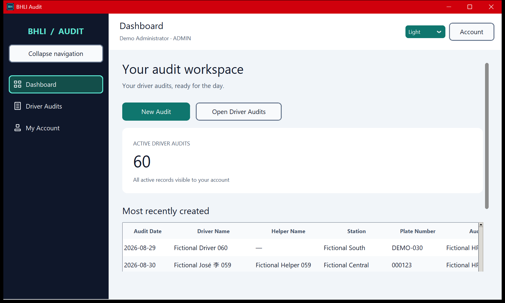
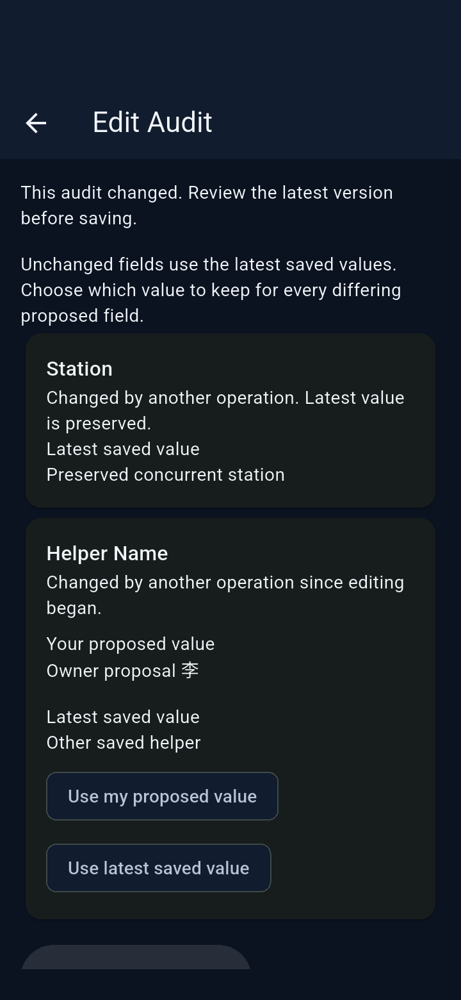
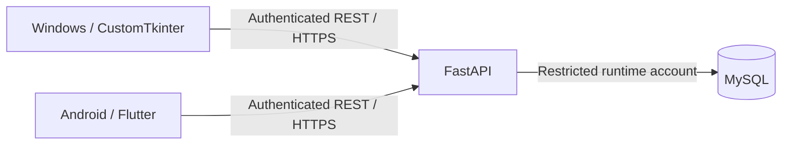

# BHLI Audit — Driver Audit Management System

**DAMS** is a shared driver-audit workspace with a FastAPI backend, a Windows
desktop client and a Flutter Android client. It supports audit creation, editing,
soft deletion, historical attribution and conflict-aware collaboration through
an authenticated REST API.

**Status:** functional development through Phase 4B is merged and operator
acceptance is complete. Phase 5 prepares a **Version 1.0 development/demo release
candidate**; it is not a production deployment or an already published 1.0 release.
See [release readiness and limitations](docs/RELEASE_READINESS.md).

## Windows and Android



*Actual frozen Windows client, Phase 3E. All displayed records are fictional.*



*Actual Android emulator, Phase 4B. Fictional data; not a screenshot of a future
Version 1.0 build. More [Windows](docs/WINDOWS_DESKTOP_PHASE3E_VERIFICATION.md#native-screenshots)
and [Android screenshots](docs/ANDROID_PHASE4B_VERIFICATION.md#genuine-emulator-screenshots).*

## What is implemented

- Search, station/date/owner filters, sorting and pagination over shared audits.
- Six editable fields: Driver Name, optional Helper Name, Audit Date, Station,
  Plate Number and optional Remarks. **Audited By** is the seventh business field:
  a server-controlled historical name snapshot tied to a stable account ID.
- Create retries with a frozen UUID idempotency key; edit/delete version
  preconditions; explicit conflict review that preserves unrelated changes.
- ADMIN-only soft deletion and archived browsing; chronological audit history
  retains original attribution and identifies each action's actor separately.
- Windows Dashboard, Driver Audits and My Account, light/dark themes, compact
  tables, minimal administrator management and safe background Excel export.
- Android touch-friendly create/edit forms, role-aware actions, history and
  session privacy; tokens and drafts remain memory-only.
- Backend account management, password reset/change, last-active-ADMIN safeguards
  and a separate ADMIN-only account-activity history API.

| Capability | ADMIN | AUDITOR |
| --- | --- | --- |
| Windows admission | Yes | Rejected; rejected token revocation attempted |
| Android admission | Yes | Yes |
| Create/read shared active audits | Yes | Yes |
| Edit active audits | Any record | Own records by authenticated account ID |
| Soft-delete / read archived audits and history | Yes | No |
| Read active audit history | Yes | Yes |
| Account administration | Backend API; minimal Windows controls | No |

Server authorization is authoritative. Android does not add account administration,
Excel/PDF export or offline synchronization. Windows exports all matching audits
to genuine `.xlsx` files; PDF and analytics dashboards are not implemented.

## Architecture and stack



Only the backend connects to MySQL. Clients contain no database credentials;
packaging a client does not install an API server or database. Explicit loopback
HTTP is used only for disposable development demonstrations.

| Area | Technology |
| --- | --- |
| Backend | Python 3.14, FastAPI, Pydantic, SQLAlchemy, Alembic, PyMySQL |
| Authentication | Argon2id passwords; opaque bearer sessions stored as digests |
| Database | MySQL 8 / InnoDB / utf8mb4; disposable SQLite fixtures |
| Windows | CustomTkinter, Pillow, openpyxl; PyInstaller + per-user Inno Setup |
| Android | Flutter / Dart, Material 3; pinned toolchain and dependency lock |
| Automation | GitHub Actions: Flutter, SQLite, disposable MySQL, Windows desktop and installer |

See [architecture](docs/ARCHITECTURE.md), [audit API](docs/AUDIT_API.md),
[authentication](docs/AUTHENTICATION.md) and [account management](docs/USER_ACCOUNTS.md).

## Try the fictional demo on Windows

Run from the source checkout using Python 3.14 with Tcl/Tk. Reuse an existing
project environment; the guarded command below creates one only if absent.

```powershell
Set-Location C:\BHLI-Audit
if (-not (Test-Path -LiteralPath .venv\Scripts\python.exe)) {
    py -3.14 -m venv .venv
}
& .\.venv\Scripts\python.exe -m pip install -r requirements.txt -r requirements-desktop.txt
& .\.venv\Scripts\python.exe -m scripts.desktop_demo
```

Choose two different fictional passwords in the hidden local prompts. Log in as
`demo_admin` or `demo_admin2` using the passwords you just chose. The demo launches
the real desktop against a temporary loopback FastAPI/SQLite server with fictional
records. It does not read production configuration, require `.env`, provision
MySQL or run production migrations. Closing the client removes the temporary
database; exported workbooks you saved remain yours to manage.

For Android, use the [fresh-session emulator/demo guide](docs/ANDROID_PHASE4B_ACCEPTANCE.md).
It starts `python -m scripts.mobile_demo`, asks for three separate hidden passwords
for `demo_admin`, `demo_auditor` and `demo_auditor_b`, and connects an explicit
debug-loopback app through ADB reverse. Use the printed current port, not an old
report's port. [Toolchain pins](docs/ANDROID_TOOLCHAIN.md) and
[Android development commands](docs/ANDROID_DEVELOPMENT.md) are documented separately.

Installed Windows clients need no Python or VS Code. See
[installation and existing unsigned candidates](docs/WINDOWS_INSTALLATION.md)
and [Excel export](docs/WINDOWS_DESKTOP_EXPORT.md). The complete supporting folder
is required for a folder-based executable.

## Security and operation

Both clients use the existing API and keep bearer tokens in memory. Sessions
expire after eight hours; logout, account-access changes and password changes
revoke the relevant sessions. Android conceals protected content while inactive
and verifies identity on resume. Authorization checks use stable IDs, not names.
Mutations and their history events commit atomically. Runtime database grants
deny DDL/DELETE and make history append-only for that account, not tamper-proof
against a database administrator.

Remote access requires trusted HTTPS and restricted networking; no TLS-verification
bypass is provided. Login throttling is process-local. Canceling a timed-out write
does not prove server rollback. Offset pagination is not snapshot-consistent, and
RAM-only uncertain-create state is lost on process death: inspect audits before
creating again. Exports are unencrypted files and cannot be retracted by logout.

**Production is a separate approval:** the supplied production state is revision
`0001`, while the application requires `0002`. Backups/restore, migration, restricted
grants, administrator provisioning, HTTPS, service supervision and maintenance
ownership must be approved and verified independently. Do not run production
migration commands merely to try the demo. See [database setup](docs/DATABASE_SETUP.md)
and [activity rollout/recovery](docs/ADMIN_ACTIVITY.md#explicitly-authorized-deployment-only).

## Verification and release status

All five post-merge jobs passed on main `dfe5789`:
[backend / SQLite / MySQL / Windows / installer](https://github.com/pauljohnsuela64-prog/Driver-Audit-Management-System/actions/runs/40853445652)
and [Android / Flutter](https://github.com/pauljohnsuela64-prog/Driver-Audit-Management-System/actions/runs/40853445787).
Historical Phase 4B local evidence records 217 Flutter passes, 549 default Python
passes/60 skips, 553 isolated MySQL passes/56 skips and 247 native Windows passes.
These suites overlap; skips are not passes and the totals must not be added.

[Release readiness](docs/RELEASE_READINESS.md) identifies exact evidence sources,
operator acceptance, pending checks and current component versions.
[CHANGELOG](CHANGELOG.md) separates merged functionality from the proposed
`v1.0.0-rc.1` milestone. No Version 1.0 artifact or production signing is claimed.

Physical-device, API 24, TalkBack and production HTTPS acceptance remain unverified.
The current local installer roundtrip was held to preserve an existing installation;
hosted disposable installer verification passed. Clean end-user Windows VM/reboot
and mixed-DPI acceptance remain incomplete. No project license has been selected
in this repository; public source visibility does not establish redistribution
permission. Production release and public binary distribution require separate decisions.
