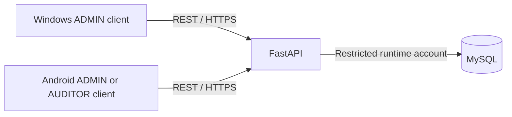

# Architecture

The implemented CustomTkinter Windows and Flutter Android clients communicate
with FastAPI through authenticated REST. Remote connections require trusted HTTPS;
explicit loopback HTTP supports disposable development demos. The backend alone
connects to MySQL. Clients never receive database credentials or perform migrations.
See [current release status and evidence](RELEASE_READINESS.md).

The backend separates configuration/transactions, SQLAlchemy entities, Pydantic
schemas, authentication repositories and transactional services. Alembic is the production schema
authority: application startup must not call `create_all`.

## Schema

Revision `0001` creates four application tables; additive revision `0002` creates
`admin_activity_events`. Current application head has **five application tables**;
`alembic_version` is separate migration bookkeeping. Supplied production state is
`0001`, not re-queried here; its upgrade/grants require separate approval.

| Table | Purpose and constraints |
| --- | --- |
| users | Unique username, required name/password hash, ADMIN or AUDITOR, active flag, creation/update timestamps |
| audit_records | Seven business fields plus actor references, timestamps, soft deletion, optimistic version, optional unique idempotency key |
| audit_events | Audit and actor foreign keys, CREATE/UPDATE/DELETE action, optional JSON before/after snapshots, creation timestamp |
| auth_sessions | User foreign key, unique 64-character token hash, creation/expiry/revocation timestamps |
| admin_activity_events | Actor/target user foreign keys, allowlisted account action, safe change metadata and creation timestamp; separate from audit_events |

All tables have integer primary keys and use InnoDB/utf8mb4 on MySQL. Foreign keys
restrict deletion to retain attribution. Date, station, plate, actor, deletion,
event creation and session expiry indexes support existing queries. Plate numbers
are intentionally nonunique: the same vehicle may appear in multiple audits.
Usernames and idempotency keys follow MySQL's configured case-insensitive collation;
clients should generate normalized opaque idempotency keys (for example UUIDs).

The business fields remain Driver Name, Helper Name, Audit Date, Station, Plate
Number, Remarks, and Audited By. Helper Name and Remarks are optional; the other
five are required and text fields must not be blank. Audited By is a stored name
snapshot (`audited_by_name`) linked to `audited_by_user_id`; the authenticated
audit service supplies both and preserves them during edits. No checklists, photos, GPS or pass/fail fields exist.

Timestamps use MySQL DATETIME(6) storing UTC. Connection initialization sets UTC
and strict SQL mode; the custom type rejects naive inputs and returns aware UTC
datetimes. Server defaults supply creation/update timestamps on insert. ORM
updates refresh `updated_at` and enforce optimistic `version`; direct SQL writers
must explicitly maintain these fields. Audit Date is a calendar date.

Deletion uses a paired timestamp/user reference. Idempotency uniqueness is enforced
when a key is supplied. The audit service atomically writes each mutation and its
event, checks account ownership, and requires version preconditions. Authentication
hashes passwords and stores only token digests. See [audit API](AUDIT_API.md).
Account mutations append separate activity events and revoke sessions atomically
where appropriate. Locked account guards protect reauthentication and the last
active ADMIN. Runtime grants prohibit changing/deleting either history store and
deny DELETE/DDL; see [activity history](ADMIN_ACTIVITY.md). Administrators/migrators retain
DDL rights, so this is not tamper-proof storage.

`session_scope` commits on success, rolls back on failure and closes its session.
Engine creation is lazy, uses pool pre-ping, hides SQL parameter values, and does
not connect at import. The caller owns engine disposal. Production configuration
rejects root accounts and databases other than `driver_audit_db`.

## Client modules and distribution

`desktop` separates HTTP contracts, immutable models, memory-only sessions,
background work and Tk-thread delivery. A separate mutation queue preserves write
outcomes across read cancellation. Dashboard, Driver Audits and My Account admit
ADMIN only. Minimal account tools reuse the backend APIs. `desktop/reports.py`
fetches all applied-filter pages and writes bounded XLSX files off the UI thread;
safe publication never overwrites an existing file. See [desktop](WINDOWS_DESKTOP.md)
and [export limitations](WINDOWS_DESKTOP_EXPORT.md).

`mobile/lib` separates transport, session-owned mutation coordination and audit
screens/controllers. ADMIN and AUDITOR can create/read shared active audits;
AUDITOR edits require stable-ID ownership. ADMIN alone can archive/browse archived
records. Exact ETags, frozen UUID/payload retries and explicit conflict choices
preserve mutation safety. History uses an allowlisted projection, ten events per
page and bounded responses. See [Android development](ANDROID_DEVELOPMENT.md).

Both clients retain tokens and protected drafts only in memory, suppress stale
results across sessions, and require re-login after expiry/401. Android conceals
interrupted screens until identity verification completes. Cancellation does not
guarantee server rollback; pagination is offset-based, not snapshot-consistent.
No offline sync or automatic background write replay is implemented.

The Windows folder/installer packages only the client; Android currently provides
an internal/debug development build. Neither installs an API/database server.
Production HTTPS, backups/restore, migration0002/grants, provisioning, service
supervision and maintenance remain separately approved deployment work.

References: [SQLAlchemy MySQL dialect](https://docs.sqlalchemy.org/en/21/dialects/mysql.html)
and [Alembic migration/version checks](https://alembic.sqlalchemy.org/en/latest/cookbook.html).
