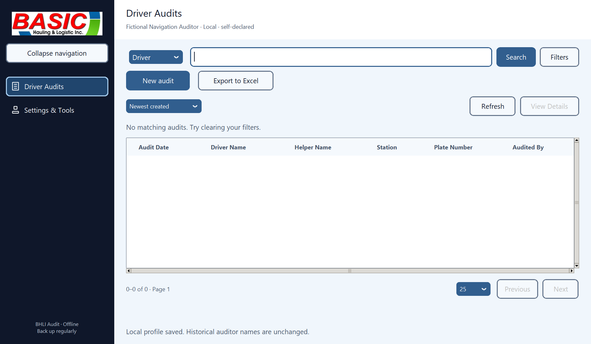
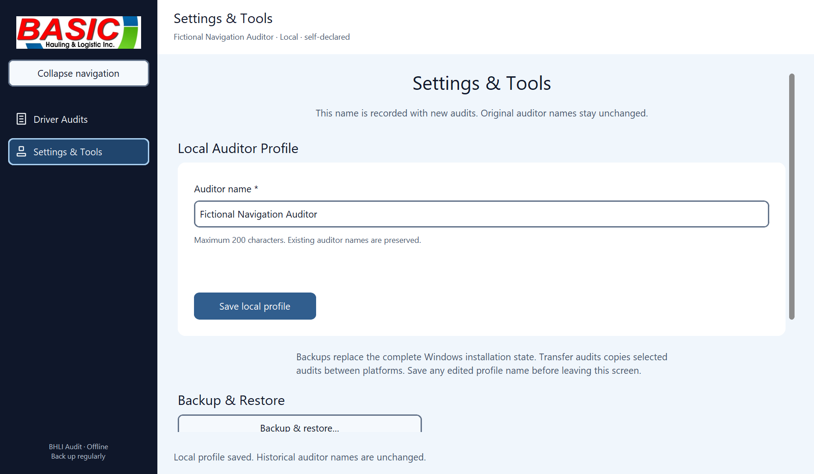
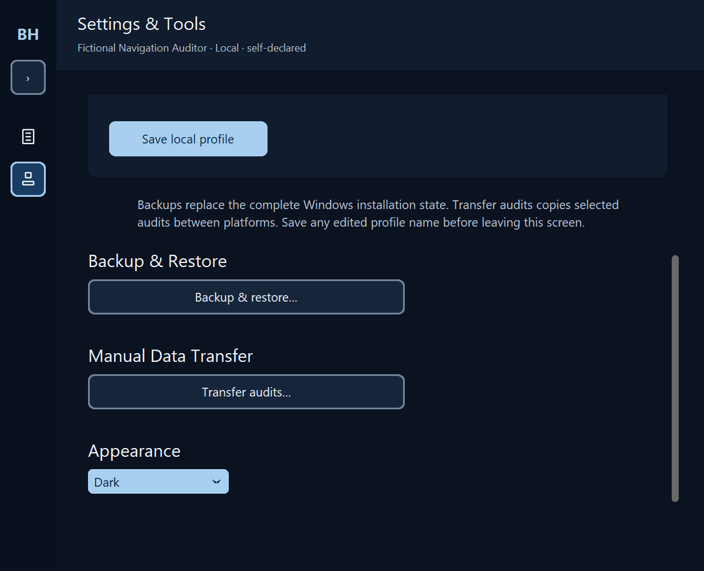
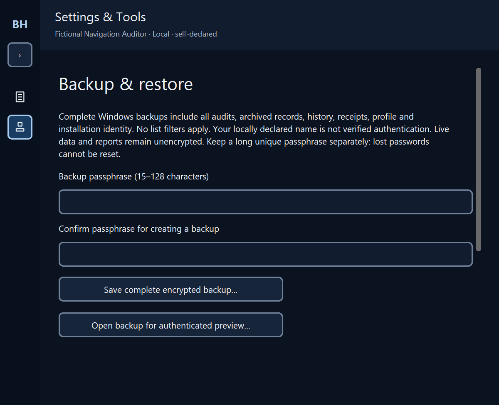

# Offline Windows navigation verification

Driver Audits is the post-welcome home. New Audit and Export to Excel remain there. Settings & Tools groups the existing local auditor profile, Backup & Restore, Manual Data Transfer and Appearance. The online client retains its navigation.

Manual sidebar choice survives resizing and theme rebuilds. Collapsed-only tooltips are delayed and placed outside their controls; navigation/destruction cancels them. History selects Driver Audits. Focus scrolls Settings controls into view. Dirty audit and profile drafts retain existing protection.

## Evidence ? 9 November 2026

- Recovered complete native desktop run: 618 passed, 1 skipped, 1 failed. The failure was the obsolete test opening Transfer from Driver Audits.
- After updating that test to open Settings & Tools: all 22 transfer/navigation/settings tests passed in 155.75 seconds. No application source changed after the complete run.
- Coverage includes 800/1200 logical widths, widget scaling 100/150/200%, both themes, repeated collapse/expand, footer rebuild, history highlighting, keyboard reveal, profile UUID and historical attribution, backup/transfer return routes and callback cleanup.
- Independent cumulative source review: no confirmed critical or important defects.
- Fresh native source-GUI capture: fictional temporary SQLite only; no Python callback errors.
- Actual OS DPI transitions, physical-pointer flicker and a new frozen/installer roundtrip were not tested. No final binaries rebuilt. Android and storage/backend contracts unchanged.

## Screenshots

