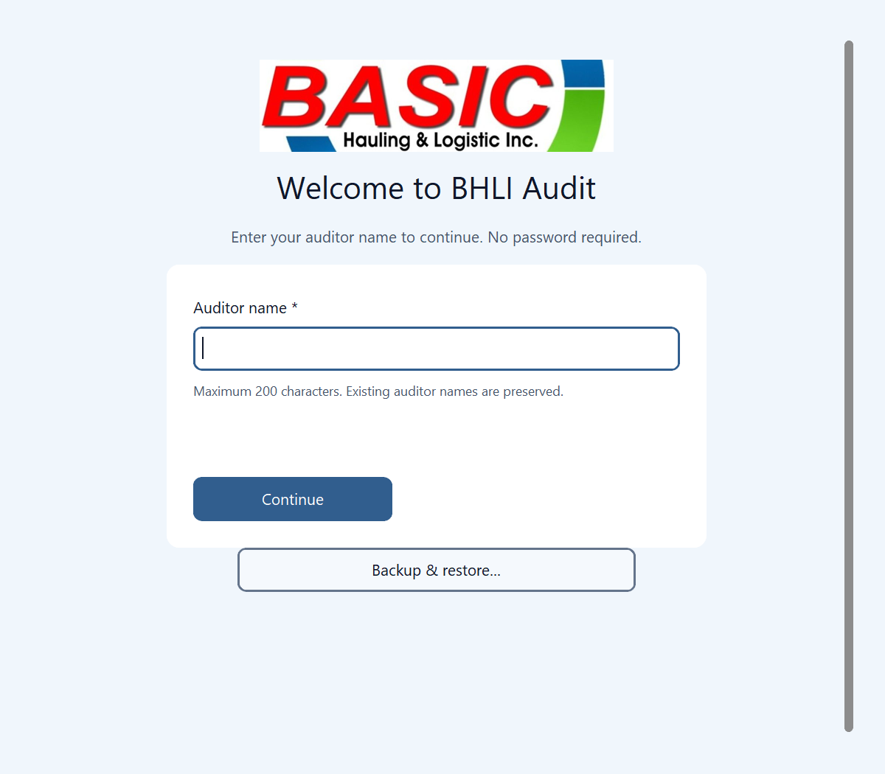
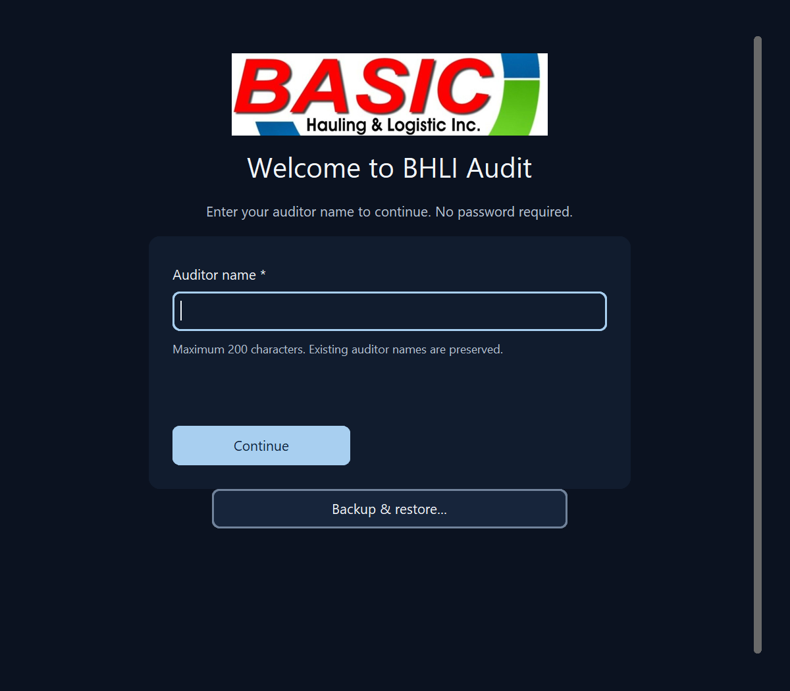

# Welcome backup alignment verification

The offline Windows welcome screen centers its existing Backup & Restore button beneath the auditor-name panel. Settings & Tools keeps its existing left-aligned grouping. The same open_backup callback, warnings, confirmations, profile storage and SQLite workflows are unchanged. No Android or online-client change.

## Evidence ? 9 November 2026

- RED: native geometry test reproduced a 500-pixel horizontal offset before the one-line correction.
- GREEN: 17 focused welcome, navigation and Settings & Tools tests passed in 61.91 seconds. Coverage includes both themes, 800/1200 logical widths and 100/150/200% widget scaling. This is not actual OS DPI-transition testing.
- Packaged candidate built from 11ab1a2dd1ecb35b12f28427362f446a02f504f9: operator confirmed centered button, prefilled name and saved records looked correct.
- Guarded packaged reopen exited normally (code 0); read-only exact row-state comparison preserved the fictional profile, two audits, two history events, identity registry, receipts and app metadata. No input injection or installed-application changes.
- Fresh source-native captures below use an empty temporary fictional SQLite database; no Python callback errors. These are not installer captures.
- Existing candidates and data preserved. No new binary build for this PR preparation. Signed distribution, clean-machine installation, revised installer roundtrip and actual OS DPI transitions remain outside this evidence.

