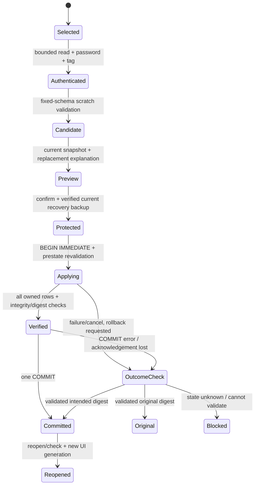

# Phase 6E — backup security, full state and restore safety

Status: **proposal, not an implemented or proven recovery guarantee**.
Companion: [Phase 6E design](2026-11-06-phase6e-offline-reporting-backup-design.md).

## Threat model and dependencies

Protect portable backup contents against reading/modification by someone without
the passphrase. Do not promise protection against an unlocked compromised device,
keylogger, malicious password holder, weak-password offline guessing, underlying
SQLite/OS failure or an operator intentionally restoring an old valid backup.
AEAD proves integrity under a derived key, not real-world employee identity,
authorization or freshness. Report files and live SQLite remain unencrypted.

Recommend standard Argon2id v1.3 + AES-256-GCM, implemented by maintained libraries,
not custom crypto. Candidate exact pins for implementation review:

| Platform | Candidate | Impact |
|---|---|---|
| Windows | Python `cryptography==50.0.2` | Published compatible Windows stable-ABI wheels; bundled native crypto and transitive licenses/hash inventory require actual CPython3.14/PyInstaller verification |
| Android | Dart `cryptography: 2.9.0` | Argon2id and AES-GCM pure-Dart implementations; run away from UI isolate; native acceleration is not assumed |

Both provide the required primitives. Python project license is Apache-2.0 OR
BSD-3-Clause; Dart package is Apache-2.0. Retain applicable license/NOTICE and
all shipped native/transitive notices. No dependency is installed by this plan.
Verify exact distribution hashes, vulnerability status, vectors, bundled OpenSSL
Argon2 support and artifact notices before pinning. Do not install a dev release
because upstream `/latest/` documentation currently points to one.

Windows should use an offline-only security requirements/build overlay so the
online runtime does not acquire a new crypto dependency. Dart shares a pubspec;
the dependency is imported only by offline code, but changed resolved inventories
still require online build/licensing regression checks. Do not claim identical
online binaries or free dependency impact. No cryptography_flutter/native plugin
is initially proposed; measured performance may require an explicitly reviewed
change, never silent weak-KDF fallback.

PBKDF2-HMAC-SHA256 (600,000 iterations) was considered for broad platform support;
prefer memory-hard Argon2id because both proposed libraries support it. ZipCrypto,
legacy encrypted ZIP and home-written AES/MAC are rejected. Standards-based
envelope framing below is application serialization, not a new cipher protocol.

## Password/key policy

- 15–128 Unicode scalar values, at most 512 UTF-8 bytes; reject invalid scalar
  encodings and control characters. Do not trim, truncate or normalize passwords.
  Confirmation compares exact bytes. Encourage a long unique passphrase stored
  independently; it need not equal a profile name or any online password.
- OS-backed random 16-byte salt and 12-byte GCM nonce for **every** encryption,
  including retry/recovery creation. Derived key is 32 bytes. No deterministic
  production randomness and no reused key/nonce pair.
- Suite 1: Argon2id version `0x13`, memory **19,456 KiB**, passes **2**, lanes **1**;
  no secret/associated-data KDF inputs. Authenticate the envelope header through
  AES-GCM AAD instead. AES key 256 bits, nonce 96 bits, tag 128 bits.
- Fixed allowlisted suite parameters, not attacker-selected work factors.
  Reject other values before derivation. No downgrade/fallback. Benchmark the
  fixed cost on supported targets; if infeasible, stop and review the design.
- Password/key material is memory-only and excluded from settings, logs,
  analytics, exception reprs, reports, manifests and recovery markers. Clear
  entry widgets and references promptly, best-effort overwrite mutable buffers.
  Python/Dart immutable strings/GC/OS paging prevent a secure-erasure guarantee.
- No password reset, escrow or backdoor. Lost password means backup unavailable.
  Wrong password and authentication-tag failure share: **Cannot unlock this
  backup. Check the password or use another backup. Nothing was restored.**
  Distinguish safe unsupported-version/size errors from authenticated preview.
  No counts/names are exposed before successful authentication.

## Envelope version 1 (`.bhlibackup`)

All integers unsigned little-endian. Exact 96-byte header, followed by ciphertext
and 16-byte tag. Entire header is the GCM AAD. No ZIP/compression or trailing data.

| Offset | Bytes | Field / required value |
|---:|---:|---|
| 0 | 8 | Magic `BHLIBAK` followed by NUL |
| 8 | 2 | Envelope version = 1 |
| 10 | 2 | Header length = 96 |
| 12 | 1 | Platform = 1 Windows, 2 Android |
| 13 | 1 | Cipher suite = 1 AES-256-GCM |
| 14 | 1 | KDF = 1 Argon2id v0x13 |
| 15 | 1 | Reserved = 0 |
| 16 | 4 | Application schema = 2 |
| 20 | 4 | Memory KiB = 19,456 |
| 24 | 4 | Passes = 2 |
| 28 | 4 | Lanes = 1 |
| 32 | 16 | Fresh random salt |
| 48 | 12 | Fresh random nonce |
| 60 | 8 | Plaintext length L |
| 68 | 8 | Ciphertext-with-tag length = L + 16 |
| 76 | 4 | Payload version = 1 |
| 80 | 16 | Reserved, all zero |

First bound the file read to **64 MiB + 112 bytes**, require exact arithmetic/
length, supported fixed fields, no overflow/reserved bits and no extra frames.
AAD tampering, truncation or wrong tag fails authentication. Public header exposes
platform, version and approximate size, not names/counts. Early structural checks
are not authentication. Only successfully authenticated metadata is trusted.

Do not parse or expose decryption output until final tag verification succeeds.
If a standard streaming interface yields early plaintext, it may go only to an
app-private quarantine stage, never to the database/UI/parser/public destination.
On authentication failure remove that owned stage or explicitly report cleanup
failure. No streaming-performance claim until actual library behavior is measured.

## Complete logical payload

Canonical UTF-8 NDJSON with sorted keys, ASCII JSON escaping, LF lines, exact
record shapes, no duplicate keys, invalid Unicode/non-finite values/unknown kinds
or trailing data. Bounded parsing: depth 6, line 1 MiB, plaintext 64 MiB; at most
20,000 audits, 100,000 events, 40,001 identities, 20,000 receipts, one profile and
the two existing app metadata rows. Limits are ceilings, not a capacity promise;
the first byte/count/time ceiling fails the **whole backup**. No filtered,
truncated, omitted-history or 'partial backup' success. Existing data is unchanged.

Payload order:

1. Metadata: payload/schema/platform/app identifiers, backup UUIDv4, created UTC,
   source app version, exact table counts and nullable audit sequence high-water.
2. `app_meta` rows sorted by key (app ID and installation UUID).
3. `local_profile` row, if present; then all `auditor_identities` sorted by ID.
4. All raw `audit_records` rows, including `seq`, sorted by sequence.
5. All raw `audit_events` rows sorted by audit ID/revision, including event UUID,
   actor/name/timestamp and exact stored before_json/after_json strings.
6. All `transfer_receipts` rows sorted by package UUID.
7. End record with exact row counts, content-byte count and state SHA-256.

Preserve stored timestamp spellings and JSON strings; do not pass raw history
through transfer normalization and rewrite it. Validate their decoded semantics
against existing accepted v2 rules, including legacy offset timestamps. Inner
JSON receives its own duplicate-key/depth/shape checks. An event's stored strings
can be valid without being canonical JSON themselves; the outer envelope is
canonical. No unvalidated names or SQL statements are executed from the payload.

Define state digest as SHA-256 over ASCII `BHLI-STATE-v1\n`, then the canonical
descriptor `{"app_id":...,"platform":...,"schema_version":2,"sequence":...}`
plus LF, then all canonical owned-row envelopes in fixed order (each plus LF).
The platform is the lowercase string `windows` or `android`; app_id is the
SQLite identity `com.bhli.audit.offline.windows` or `com.bhli.audit.offline`,
not the Windows installer AppUserModelID. Sequence is the nullable watermark.
Exclude backup UUID, generation time, cipher salt/nonce and the end record. Thus
two snapshots of unchanged state have the same digest. Each row envelope has
exactly `kind` (the table name) and `row` (exact known SQLite column names/values).
Metadata's counts use those table names; it also has `kind=metadata`,
`payload_version=1`, `schema_version=2`, `platform`, `app_id`, `backup_id`,
`created_at`, `source_version` and `sqlite_sequence_audit_records`. No other keys.
Creation time is UTC with six fractional digits and Z; source_version is a
bounded informational string. The end record has exactly `kind=end`, `rows`
(total owned rows, excluding metadata/end), `content_bytes` (all prior payload
bytes including metadata/newlines) and `state_sha256`. All declared counts,
identities/platform/schema/lengths must match the header and actual stream.
Golden fixtures must lock these bytes before implementation changes. This digest
supports revalidation/readback, not authenticity in place of AEAD.

Create/inspect using a fresh scratch SQLite database with **fixed built-in v2
DDL**, parameterized inserts, foreign_keys ON and strict validators. Never ATTACH
an imported raw database or run its DDL. Check schema ownership, types, UUIDs,
names, dates, all complete CREATE/revision chains, final snapshots, identity
references, receipts and sequence >= max audit seq. Preserve unused identities
and receipts; do not try to recompute receipt hashes from unavailable old files.
Validate receipt fields, not an invented link to current record counts.

Scratch state and payload are private generated artifacts, not user databases.
Full backups are same-platform compatible, not byte-interchangeable raw SQLite.
Preserve Android native metadata in its active database and exclude it from the
logical state. Reject a different platform/app ID even when the password works.
Empty application databases are valid backups and restore to profile setup.

## Snapshot, files and storage

Use one owner-thread/queued read transaction for schema, metadata, counts, rows
and sequence. Establish its snapshot on the first read. Stream bounded rows to
an owned private stage; no repeated public list calls or live-file copy. Verify
state before encryption. WAL contents are included through SQLite reads, not by
copying `-wal`/`-shm`. A Python backup API could be an internal future adapter,
but is not needed for this portable logical design.

Private staging lives only in an offline-specific protected user data directory
(Android filesDir / Windows per-user data ACL), with UUID-generated names and no
symlink/path escape. Separate transient stages from retained encrypted recovery
backups. Wipe-by-deletion is best effort, not secure flash erasure. Do not stage
plaintext beside a public save destination. Restart cleanup removes only owned
transient files with the exact naming policy, never user-selected sources,
active databases, Phase 6D stages or retained recovery backups.

Initial scratch budget: 512 MiB and a 10-minute operation timeout, in addition to
SQLite journal/database space. Preflight free space against measured current and
candidate sizes, budget for current/target stages, encrypted copies, scratch DB
and rollback/WAL growth. Free-space checks are advisory; every actual write,
flush, close, readback and COMMIT remains a checked failure point. Abort without
data changes if the mandatory recovery backup cannot fit the limits. Measure
native peak RSS/temp disk/KDF duration with the near-limit payload; no claim of
64 MiB success on every phone or worst-case row count. Never reduce KDF strength
silently to pass a performance test.

Windows publishes only finished, flushed files under a new destination name,
with a platform-tested no-replace operation. Android uses local-preferred SAF,
exact generated stages and bounded 64 KiB copying. A new purpose-limited adapter
may share tested internal copy logic with transfer, but cannot turn transfer's
32 MiB capability into an arbitrary-file channel. Backups allow only backup
artifact handles and this envelope cap; text reports have their separate cap.
No broad storage permissions, automatic cloud provider selection or Internet.
Read back/check the destination before success; provider guarantees are not
equivalent to filesystem atomic rename. Cleanup only the current CREATE_DOCUMENT
URI on failed/cancelled output; if deletion is refused, warn that an incomplete
file remains and never advertise it as a usable backup. Never delete import
sources or existing outputs. Keep the verified private encrypted artifact until
publication succeeds or the operator explicitly dismisses a failed-save recovery.

## Restore protocol

1. Copy the selected encrypted file into a bounded private immutable stage; bind
   its digest to the inspected candidate. Never reread a mutable selected source
   when applying. Authenticate, decrypt and validate off the UI thread; no active
   DB writes yet. Reject wrong platform/schema/format and arbitrary SQLite files.
2. Acquire a maintenance lease: stop new mutations/imports/reports/profile edits,
   drain admitted work and warn about unsent drafts. Read current full-state
   digest/counts on the owner. Preview backup date/platform/profile/installation,
   active/archived/history/receipt counts and current→restored comparison.
3. Explain **all current records, profile, installation identity and receipts
   will be replaced**, not merged. Require explicit acknowledgement and a final
   Replace this device's data action. Default is Cancel. Select a new recovery
   destination before final application (no picker while holding a write lock).
4. Create a **complete encrypted recovery backup of current state**, fresh salt/
   nonce, using the entered passphrase. Reuse the password, not the original
   derived key/nonce. Show: 'Your current data will be protected using this backup
   password.' Retain a verified private encrypted copy and successfully publish/
   read back the selected new recovery destination. Authentication and state
   digest must prove it matches preview's current state. Failure/cancel aborts
   restore. Preserve recovery files after successful or interrupted restoration;
   no automatic retention deletion in this phase.
5. Verify the process-wide exclusive offline-store lease described below remains
   held. Before opening the write transaction, configure/read back foreign keys
   ON and synchronous=EXTRA (FULL behavior in WAL; additional rollback-journal
   directory protection). Preserve the owned journal mode; never disable
   journaling or copy/checkpoint WAL files as a restore shortcut. Native
   acceptance must confirm actual pragmas/behavior on API24/API36/Windows.
6. Write/flush the required private recovery marker described below, then acquire
   `BEGIN IMMEDIATE`/equivalent write reservation. Re-read current state and
   require its digest to match the protected preview. A race causes rollback
   and a fresh preview, not automatic backup/restore retry. A lost lock or failed
   marker write aborts before replacement. No system picker remains open here.
7. In one transaction, delete known owned rows in dependency order (events,
   receipts, audits, profile, identities, app metadata), then insert validated
   rows in dependency order with explicit columns and IDs. Restore sequence
   watermark/absence using fixed statements. Keep schema/user_version=2, indexes
   and Android native metadata. There is no filesystem database replacement or
   DDL from the backup. This intentional replacement is available only after
   confirmation/recovery proof; normal transfer never gains deletion powers.
8. Before COMMIT, verify complete row counts, state digest, full semantic history,
   schema ownership, integrity_check and foreign_key_check in that transaction.
   A confirmed pre-COMMIT failure/cancellation requests rollback on the owning
   adapter. Do not restore via independent table transactions. COMMIT exceptions
   and lost acknowledgements require outcome classification below, not a promise
   of rollback. Only report ordinary success after checked COMMIT; cancellation
   after it does not undo restored data.
9. Close/reopen the owner normally, recheck state/digest, clear drafts/caches and
   advance UI generation before leaving maintenance. No callbacks may show the
   old profile/records. If a post-COMMIT check/open fails, block normal writes;
   retain both encrypted files and offer the explicitly scoped recovery path
   below. Do not silently roll back a committed restore or initialize a new empty
   database. If source and current state digests already match at preview, report
   that nothing needs replacement and skip the write workflow.

Freshly generated recovery backup creation, verification and final restore may
take time; progress distinguishes these phases. Before final write admission,
Back cancels without changing current data. During transaction it requests
rollback and waits; after COMMIT completion is truthful. Window close drains
admitted work using existing lifecycle rules. Passwords/drafts are not persisted;
after process death there is no automatic retry or restoration.

## Crash and failure recovery

| Interruption | Expected supported result |
|---|---|
| Before recovery backup is complete | Active state unchanged; owned partial output cleaned or warned |
| Recovery saved, before transaction | Original active state; complete recovery remains |
| Confirmed pre-COMMIT failure with successful rollback | Original state, confirmed by state validation |
| COMMIT exception/lost acknowledgement or process termination near COMMIT | Reopen and classify original/restored/unknown; never promise rollback from the exception alone |
| COMMIT complete, before UI/reopen | New complete state; startup validates it before writes |
| Storage/OS violates sync assumptions or active state fails validation | Fail closed; retain database and encrypted recovery; operator-led recovery, no empty reset |

A required, flushed private operation marker (maximum 4 KiB) precedes every replacement
transaction. Exact allowlisted fields: marker version, operation UUID, platform/
app ID, original and intended state digests, input ciphertext digest, generated
private encrypted input/recovery filenames and their digests, and stage. No
passwords, keys, profile names or arbitrary file paths. Generated files must be
inside their owned directory and must not be symlinks. Retain the frozen encrypted
input and recovery copy until outcome resolution; cleanup cannot remove them as
ordinary orphan stages. Only one pending operation is allowed.

The marker is a recovery aid, **not** commit authority or permission to restore.
At startup inspect it before transient-stage cleanup or normal UI admission.
SQLite performs its ordinary journal recovery; validate the resulting owned
state before writes. For an ambiguous COMMIT result, the adapter rolls back only
if a transaction is still active, then closes/reopens and classifies:

- **ORIGINAL:** digest matches protected original; report replacement did not
  take effect and require a fresh user-confirmed attempt, never automatic retry.
- **RESTORED:** digest matches intended candidate; report restored state is
  present and retain recovery files. Do not reverse it because acknowledgement
  was lost.
- **UNKNOWN:** neither digest matches, state cannot be validated, or required
  evidence cannot be trusted; block normal writes, retain all database/recovery
  files and offer assisted recovery. Do not say 'nothing changed'.

Missing/corrupt/stale markers never authorize deletion, reset or blind replay.
If evidence for the last operation is missing, validate current state but do not
claim to know that operation's outcome. No plaintext password enables unattended
recovery. Test a real COMMIT followed by an injected exception/lost result, not
just failures before COMMIT. Marker update/cleanup errors cannot turn a verified
restored state into a false failed-save claim.

## Exclusive owner and corrupt-current scope

Every cooperating Phase 6E offline instance acquires a per-data-directory native
OS lease **before opening SQLite** and holds it until all admitted operations
drain and its connection closes (or the OS releases it at process death). It is
not acquired only at restore time. The lease belongs to the process-wide local
store, never an Activity/widget; rotation must not release a live store. Windows
and Android adapters must test competing processes/engines, abandoned leases and
shutdown. A second owner receives a clear close-the-other-copy/retry message;
the application never kills another process. Older builds/external SQLite tools
cannot honor the new lease: closing them is an explicit operator precondition,
not a claimed exclusion of hostile local writers. SQLite's write reservation
and final digest revalidation still protect races before the transaction.

Operator-selected recovery scope (whole design still awaiting approval): in-app full restore requires a readable valid
owned current v2 store, including a fresh empty installation. **Already corrupt
or unopenable current databases do not enter in-place restore**, because a
complete current recovery backup cannot honestly be produced. Bootstrap failures
must retain the existing files and offer Retry plus accessible assisted-recovery
instructions, rather than a misleading Restore button that cannot proceed.

Assisted recovery uses a separate fresh same-platform instance/data directory
and the valid encrypted backup, leaving the damaged original and all its
sidecars untouched. Establishing that fresh supported target is an explicit
operator-assisted activity, not an automatic delete/reinstall, live-file move,
raw-file replacement or path bypass. The normal restore workflow can then back
up that empty target and restore the selected state. The operator must retain
the damaged installation for recovery and retire duplicate active identities.
This phase does not promise automatic repair/activation of a corrupt current
store. If that capability is required, stop for a larger recovery-bootstrap/
storage-activation design before implementation. This material scope choice is
explicitly included in the operator approval request. Concrete supported targets
are a separate Windows OS user/new Windows PC with its normal private data path,
or a separate Android device/OS user with its normal app sandbox. Secondary-user
availability varies by Android device; it is not promised for every phone.
Do not add an arbitrary database-path override or suggest uninstalling/clearing
the damaged application as the recovery procedure.

Transactions provide an old-or-new logical state under SQLite's documented
filesystem/sync assumptions; they are not a promise against every power loss,
broken device, malicious writer or full disk during subsequent filesystem
recovery. Test real process termination at every defined stage, full/IO/COMMIT
faults, WAL and rollback journal modes. Physical power-cut durability remains a
separate explicitly reported acceptance limitation unless actually tested.

## Deployment gate

These encrypted backups do not secure the existing plaintext unauthenticated
`.bhlitransfer` workflow. Employee deployment still needs a separately approved
transfer confidentiality/source-trust milestone, device/access/storage policy,
physical/API24/installer/clean-machine acceptance and restore-drill evidence.
Do not silently change Phase 6D files or claim a locally declared auditor has
become a verified employee because a backup decrypts successfully.
