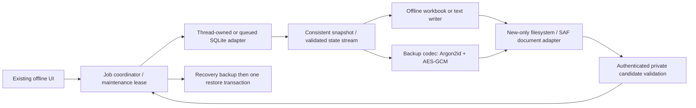

# Phase 6E — offline reporting, backup and restore

Status: **proposed design; operator approval required before implementation**.
Baseline: `d613dae935ddbb3607b828feccf48df1736241e4` (merged PR #15).
Branch: `feat/dams-offline-reporting-backup`.

## Intent and scope

Give one or two HR operators useful local reports and recoverable local state,
without Internet, an API, MySQL, a cloud account or a background server. Continue
fictional-data development only. Preserve the original online applications,
offline installation identities, seven audit fields and Version 1.0 release.

This document proposes Windows XLSX, Android summary/plain-text reporting,
password-encrypted full backups and explicitly confirmed same-platform full
restoration. It does not approve implementation, employee deployment, automatic
backup/synchronization, PDF, a Reports sidebar, transfer-format changes, account
authentication, database encryption, packaging publication or Phase 6F/6G work.

The operator selected **Android summary + readable UTF-8 text report** and
**assisted recovery into a fresh same-platform instance for corrupt current
storage** during design. Other engineering choices below are recommendations
for approval; the complete document still requires approval before implementation.

## Existing architecture and reuse

- Windows `desktop/offline/repository.py` owns one SQLite connection on its
  `DatabaseWorker` thread. Each operation has an explicit transaction; admitted
  writes drain before shutdown. UI work belongs to Tk's thread.
- Android `SqliteOfflineRepository` serializes transactions through `_tail`;
  sqflite owns native SQLite. A `Transaction` must never escape to a Dart isolate
  or be mixed with calls on the parent database inside its callback.
- Both use owned schema v2: app metadata, singleton local profile, identity
  registry, audit records, events and transfer receipts. Android also has native
  `android_metadata`; it is not a portable application table.
- `desktop/reports.py` combines good XlsxWriter policies with REST pagination,
  `ApiError`, token deadlines and an offset-consistency caveat. Importing it into
  the offline build would violate `scripts/build_windows_offline.py` exclusions.
  Keep it and `desktop/export_ui.py` unchanged. Reuse XlsxWriter 3.3.0, the tested
  formatting policies and readback test cases in a small offline-only writer;
  do not copy its authentication, fetching or pagination implementation.
- Phase 6D codecs provide useful strict JSON/history validation primitives and
  fictional fixtures. They are not full-backup codecs: they omit local profile,
  receipts, sequence and installation state and deliberately refuse overwrites.
  Neither their file format nor their existing resource limits will be changed.
- Native `TransferDocuments` owns only generated transfer stages and its current
  create-new URI. Do not broaden its path policy or overload transfer methods
  with arbitrary report/backup paths.

## Approaches considered

| Approach | Advantage | Rejection/tradeoff |
|---|---|---|
| Platform-bound, encrypted logical full-state snapshot; transactional restore | Both SQLite adapters can enumerate/restore known state without copying a live file; retains v2 | More validation than raw copying; deliberate replacement needs maintenance coordination |
| Native SQLite backup API / database-image replacement | Python has a good snapshot primitive; convenient forensic image | sqflite has no existing matching interface; raw Android metadata/WAL and live file replacement complicate API24 support, connection ownership and rollback |
| Extend `.bhlitransfer` into merge/backup | Existing UI/code | Violates transfer semantics; cannot restore full local identity/receipts or replace existing versions |

Recommend the first. SQLite's backup API is legitimate, but do not assume a
filesystem copy, Android `VACUUM INTO` availability on the minimum OS, or two
renames constitute a portable atomic restore. Keep full restoration platform
bound; use Phase 6D to copy audits across platforms.

For Android reporting, CSV was rejected because ordinary spreadsheet opening
can coerce leading-zero identifiers; a formula such as `="00123"` is not an
acceptable workaround. Android XLSX would introduce another writer dependency.
The selected text report is readable in Files/text viewers and preserves literal
identifiers without spreadsheet execution semantics.

## Module interfaces and ownership

Use deep modules with a small interface, not UI calls into raw SQL or native
paths. Proposed interfaces are conceptual, not implementation scaffolding:

- `Reports.prepare(applied_filter, cancel, progress)` returns an immutable
  summary/report artifact from one read snapshot; publication is separate.
- `Backups.prepare(password, cancel, progress)` captures **all** owned state and
  returns a verified encrypted artifact, never a filtered transfer.
- `Restore.inspect(frozen_backup, password)` returns a validated candidate and
  preview; `Restore.apply(candidate, preview_token, recovery_destination)` owns
  maintenance admission, recovery proof, prestate revalidation and commit.
- Filesystem and Android SAF are adapters at the publication seam. Expose
  bounded handles/generated artifact IDs, not arbitrary paths from the UI.

Windows reuses the owning database worker and posts bounded/coalesced progress
to Tk. Android keeps SQLite work on its queue and CPU-heavy serialization/KDF/
cipher work off the Flutter UI isolate. File stages are immutable after sealing;
pass generated paths/digests to workers, not captured widgets or transactions.
Only one reporting/backup/restore job per application is admitted at a time.
All Phase 6E offline instances take a process-wide store lease before opening
SQLite and retain it through drained shutdown; restore does not acquire a
too-late screen-only lock. Long-lived file jobs use durable admission so normal
list cancellation/navigation cannot discard their final result.

## Windows report

Driver Audits gains **Export to Excel**, alongside New audit/Transfer audits.
No new sidebar destination. Export the complete matching result, never just the
visible page. Use the last **applied** driver/plate/station/date/archive/sort
filter; require pending edits to be applied or discarded first. Do not invent
an auditor filter absent from the offline contract. An explicit All audits
choice clears filters visibly; date range is inclusive. Default archive behavior
matches the applied list, with a clearly shown Include archived option.

The database adapter performs count, iteration and report metadata reads in
one read transaction and fixed deterministic order (existing sort plus stable
sequence/ID tie-break). Do not call the paged public list repeatedly in separate
transactions. Capture immutable bounded rows or spool them privately while the
snapshot is open; then release SQLite and format outside the UI thread. The
report says **point-in-time local snapshot**, not the online offset caveat.

Workbook:

- **Audits:** Driver Name, Helper Name, Audit Date, Station, Plate Number,
  Remarks, Audited By, Record ID, Status; exactly the seven existing business
  fields plus ID/status. Original audited-by snapshot, not current profile name.
- **Report information:** generated UTC, snapshot UTC, exact applied filters and
  ordering, row/active/archived counts, offline development edition and
  unencrypted-report warning. No passwords, key material or backup contents.
- Explicit `write_string`/text cells, text number format, automatic formulas,
  URLs and numeric conversion disabled; freeze header, filter row, sensible
  column widths and wrapped remarks. No macros, formula cells, external links
  or hidden untrusted workbook metadata. Empty optional values are blank.
- Preserve full Unicode and original text values, including leading zeros.
  Escape XML control characters using the library's tested string handling;
  fail if a value cannot be written fully. Never silently truncate remarks.

Initial ceilings: 20,000 records, 100 MiB row text, 256 MiB temporary workspace,
10 minutes. Enforce limits while reading/writing and recheck finalization space;
an exceeded limit means no complete report is published. Empty exports produce
a clearly labelled zero-record workbook with headings/info, not a false error.
No claim that all 20,000 worst-case long-remark records fit the byte ceiling.

Choose a new `.xlsx` destination. Finish/flush/validate a private or same-volume
owned staging file, then use a tested platform-specific no-replace publication
operation. Preserve Windows FAT/exFAT support; do not reuse POSIX-only hard-link
assumptions. Check cancellation before publication. A late cancel does not undo
a completed save; cleanup failures say which owned temporary artifact may remain.

## Android summary and readable report

Audit-list action **View report summary** opens a scrollable screen using the
applied driver/plate/station/date/archive filter and ordering. Summary count
queries use one transaction: total matching across both statuses, active,
archived and displayed-scope counts. Explain that Include archived changes the
result set; active + archived reconciles with the all-status matching total.
List/detail navigation retains the user's filters. A refresh explicitly takes a
new snapshot rather than pretending separate interactive pages are frozen.

Show date range and at most ten station breakdown rows plus an explicitly
labelled aggregate **Other stations**; totals include every matching station.
No charts, analytics dashboard or new audit fields. Results remain searchable
through existing Driver Audits; selecting a summary link returns to that list.

**Save text report** creates UTF-8 `.txt` with a title, generated/snapshot UTC,
filters, summary counts, then all matching audits in stable order. Each audit
has a separator, ID/status and seven labelled fields; optional blanks say Not
provided. Multiline values are indented/quoted so remarks cannot masquerade as
another field or a new record. Preserve Unicode/identifiers and display control
characters safely without interpreting markup, links or formula syntax. It is
not CSV or an Excel-import contract. Use the same 20,000/100 MiB/10-minute limits,
with a bounded private output stage; publish nothing presented as complete when
any limit is exceeded. Summary-only counts need not load every audit into RAM.

Use ACTION_CREATE_DOCUMENT with `text/plain`, local-only preference and an exact
generated artifact; no broad storage permission or report package dependency.
After saving, users may share the selected file through Android Files. An
in-app share intent and FileProvider expansion are deferred. No automatic viewer
launch, Internet access or upload. Readback verifies the saved byte digest;
failed-save cleanup targets only the current newly created document.

## Full backup and compatibility

Use `.bhlibackup`, distinct magic and UI from `.bhlitransfer`. Payload version 1
captures every application-owned v2 row, including archived records, current
profile or its absence, installation identity, unused registered identities,
original attribution, complete raw stored history JSON and receipts. Preserve
audit sequence numbers and the AUTOINCREMENT high-water mark, including absence
on a fresh database. Exclude only native Android metadata, disposable files,
UI navigation state, binaries, logs and online configuration—not owned audit
state. Backups are complete snapshots, not incremental and not date-filtered.

No SQLite schema migration is proposed for Phase 6E. Creation requires a valid
owned v2 database; normal existing v1→v2 startup migration remains separate.
Restore supports backup payload v1 / schema v2 / **same offline platform/app ID**
only. No SQL from a file is executed. A same-platform replacement device may
restore; cross-platform full restore and future/foreign schemas are refused.

Restoration replaces the receiving profile and installation UUID with the
backup's values, unlike import. This is recovery of that logical installation,
not cloning a second active device. Preview and confirmation must explain this.
Operator must stop using the original copy; the software cannot prove another
offline device was retired. To copy data while retaining both device identities,
use Transfer audits. No new employee-authentication claim follows from restore.

See [backup/security/restore specification](2026-11-06-phase6e-backup-security-restore.md)
for the complete format, limits, protection and crash-state protocol.
The proposed in-app restore scope is valid-current or fresh-empty storage.
Already corrupt/unopenable current stores require non-destructive assisted
recovery into a separate fresh same-platform target; automatic corrupt-store
repair is a separate material approval decision, not a hidden guarantee.

## UI and lifecycle

Windows retains Dashboard, Driver Audits and Local profile. Backup & restore is
a subordinate panel within Local profile, reachable even before a profile is
created. Android retains the local-profile action and adds Backup & restore
there, also accessible from empty first launch. Existing transfer/CRUD/history
actions remain. Update the development warning accurately after verified backup
support exists; never imply that a backup on the same device is disaster recovery.

Create Backup: choose/confirm passphrase → capture all state → encrypt/validate
→ choose new destination → save/readback → show confirmed location/time/counts.
Android may reserve a create-new URI before processing; empty reserved output
is not success and must be cleaned up on cancellation/failure.

Restore: select → unlock → validate → preview → reserve new recovery destination
→ explicitly confirm replacement → protect current state → restore/verify →
rebuild profile/list/UI from the database. Warn before discarding unsent forms.
Details/summary caches and drafts are erased after restore; old completions
cannot repopulate them. No automatic restoration after process death.

Use existing navy/teal light/dark designs, 48dp Android controls, 320dp and 200%
text acceptance, Windows compact/high-DPI layouts, scrollable screens, visible
labels, focusable password visibility toggles, accessible progress and keyboard
operation. Default restore dialog focus is Cancel. The final button says
**Replace this device's data**; a required acknowledgement states profile,
identity and all local records will be replaced. Do not require typing an
English keyword as the only accessible confirmation. Colours never carry the
warning alone. Give Back/Cancel a truthful phase-dependent meaning.

## Milestones and approval decisions

The [acceptance/checkpoint document](2026-11-06-phase6e-verification-checkpoints.md)
lists outcomes, RED/GREEN tests and stop gates; a detailed implementation plan
is written only after design approval.

Operator approval is requested for: (1) same-platform logical full backup/restore
and replacement of profile/install identity; (2) encrypted portable files with
no password recovery; (3) mandatory verified pre-restore recovery backup and
replacement confirmation; (4) proposed fixed crypto suite/dependency candidates;
(5) initial resource ceilings and explicit refusal beyond them; (6) desktop
XLSX and the already selected Android summary/text scope; (7) assisted recovery
for corrupt/unopenable current stores instead of automatic repair. Cross-platform full
restore, CSV, native sharing and transfer encryption are excluded/deferred.

No implementation, package installation, production operation, push, PR, tag or
release is authorized by committing this design.
