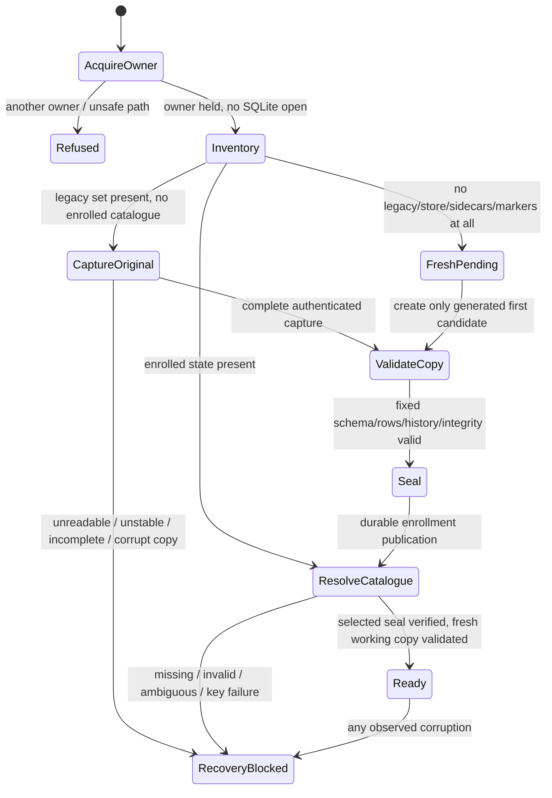

# Phase 6E Android recovery-safety amendment

Status: **PROPOSED — explicit operator approval required before implementation.**
Design/research only; branch `feat/dams-offline-reporting-backup`, input HEAD
`4f7b6dc8d7c43c1ffe218da559baf467c2559187`. This is a material Android storage
amendment, not clearance for Phase 6E or employee deployment.

## 1. Decision and scope

Recommend **immutable protected originals and encrypted sealed generations,
with isolated SQLite working copies and durable publication before save success**.
Keep the platform SQLite engine and pinned sqflite 2.4.5; retain a narrowly
reviewed offline-only handler/latch as defence in depth, not preservation proof.

The operator is being asked to approve these new engineering decisions:

- Never give SQLite a protected original or sealed-generation path, even for a
  read-only probe. Original legacy database/sidecars stay at their existing paths.
- Protect each acknowledged logical state in a separately sealed generation;
  publish every mutation before acknowledging it. No startup-only snapshot.
- Use a fixed, app-private managed-generation directory and atomic selector;
  this replaces Android's single live-file authority. It is **not** permission
  for arbitrary paths, raw-file restore, automatic repair or user-data deletion.
- Encrypt retained physical copies using a distinct Android Keystore AES-GCM
  key. This adds a device-bound key lifecycle; losing it can make local sealed
  state unreadable. Portable passphrase backups remain essential and unchanged.
- Explicitly accept the runtime guarantee in section 4: protect the original
  and last published state; **exact-at-detection bytes of a changing working
  database are not provided by this architecture**. This is a contract amendment.
- After a disposable-workspace failure, offer only explicit same-generation
  verification/resumption under section 9, never automatic retry or promotion.
  Corrupt/unreadable authority still requires separate-instance assisted recovery.

No Windows storage change, schema version, audit business field, online behavior,
transfer format, portable-backup cryptography or assisted-target policy changes.
Do not implement, install dependencies, modify the partial plugin patch, run
native experiments, push, create a PR/release or start Phase 6F/G for this design.

## 2. Root cause and verified inputs

The [complete safety review](../research/2026-11-07-phase6e-android-corruption-safety-review.md)
records native API 36 evidence:

| Input | Actual result |
|---|---|
| Original pinned plugin | 3 tests, 2 failures: writable startup resets corrupt main; runtime corruption deletes it |
| Partial nondeleting-handler patch | 5 tests, 4 failures: startup sidecar loss, WAL close mutation, queued-cursor success; one read-only harness assertion issue |
| WAL before/after failed query | Main/WAL/SHM hashes unchanged |
| Same WAL connection after close | Main grows 16,384→20,480 bytes; WAL/SHM removed |
| Host regressions / provenance | 42 and 19 passed respectively; not native clearance |

Both retained tar archives and every recorded original fixture were reverified
read-only for this amendment: 10 baseline and 13 extended original-file copies.
Archive SHA-256 values:

```text
baseline f53aab77d523dd27339177f4538c42b3d359eb8027710124fb86029a0f232d39
extended 8721a43d4b469ba3b9f0263170036390a0d4043afaac56d1b74b23bd13f528ee
```

Android's default handler is one destructive path; ordinary SQLite recovery and
close are separate paths. A read-only version query already opens/closes the
original in today's repository. Restore reopen and error cleanup do likewise.
All must move behind the new module; protecting only writable startup is unsafe.
SQLite documents WAL as persistent state and last-connection cleanup; it also
warns against copying active transactions or separating journals from their
database. [WAL lifecycle](https://www.sqlite.org/wal.html),
[copy/journal hazards](https://www.sqlite.org/howtocorrupt.html).

## 3. Independent comparison of the two options

| Concern | A: supported native lifecycle controls | B: immutable originals and sealed generations |
|---|---|---|
| Startup damage | Requires preventing every recovery/metadata/sidecar mutation before detection | Original is inventoried/copied with file I/O only; SQLite opens a different path |
| Runtime damage | Requires an engine-level stop before cleanup; cannot undo earlier writes | Last acknowledged generation is already protected; failing working copy is separate |
| Checkpoint/close | Must control rollback, automatic checkpoint, close, finalizers and reopen together | Normal cleanup can affect only working copies |
| Sidecars | Nondeleting handler alone demonstrably insufficient | Original complete file set and explicit absences retained; never mix generations |
| sqflite/API 24 | No complete documented supported control established by this research | Retains engine/plugin, adds internal path authorization and generation coordination |
| Dependencies/licensing | A replacement engine/JNI/VFS may add maintenance, ABI and licensing work | Standard Android filesystem/Keystore APIs; existing plugin patch provenance still required |
| Resources | Potentially less copying, but mechanism unproven | Full-generation I/O, disk amplification, encryption and key availability costs |
| Crash consistency | Needs proof across all native lifecycle paths | Separate candidate, immutable seal and durable selector with explicit UNKNOWN state |
| Maintainability | Small if a supported complete solution exists; large if custom engine/VFS needed | Larger storage module, but one auditable publication rule for every mutation |

Option A is not declared technically impossible. SQLite exposes a C-level
no-checkpoint-on-close option, but that alone does not prevent startup journal
recovery or SHM changes, and the pinned Android wrapper does not expose a complete
preservation interface. Android OpenParams is API 28+, not a uniform minimum-24
solution. Do not use reflection into hidden platform pointers, leak connections,
disable journaling, or infer safety from turning off automatic checkpoints.
[SQLite connection configuration](https://sqlite.org/c3ref/c_dbconfig_defensive.html),
[Android OpenParams](https://developer.android.com/reference/android/database/sqlite/SQLiteDatabase.OpenParams.html).

Option B is recommended because it avoids opening protected files at all. A
snapshot made only after corruption is too late; a startup-only snapshot loses
the protection of acknowledged session changes. Both are rejected variants.
`immutable=1` is not a way to mark a live database safe: it asserts immutability
and skips locking/change detection. Do not use it on originals or live copies.
[SQLite URI contract](https://www.sqlite.org/uri.html).

## 4. Exact preservation contract

Three different objects must never be called the same "original":

1. **Legacy original:** the pre-amendment `bhli_offline.db` and its existing
   `-wal`, `-shm`, `-journal`, with recorded absences. The manager never writes,
   renames, deletes, repairs or supplies these paths to SQLite. Before the first
   SQLite operation anywhere, inventory and copy the quiescent complete set.
2. **Published generation:** an authenticated encrypted physical file set from a
   fully validated, closed candidate, plus its logical digest. Once sealed it is
   never edited or opened with SQLite. Current and predecessor are retained.
3. **Working copy:** a generated private plaintext copy used by SQLite. Its
   journal recovery, locale metadata, writes and close can change its bytes.
   It is not the legacy original or the published generation.

| Situation | Guarantee, assuming intact OS/storage and excluded competing writers |
|---|---|
| Existing damage before first open | Legacy original bytes, file presence and names unchanged; complete physical capture verified before testing a copy |
| Damage discovered while validating an initial copy | Original/capture retained; no application state admitted; no automatic activation |
| Damage during a read or write | Last published generation retained exactly; all normal operations latch closed; working copy is pinned for diagnostics |
| SQLite changes before detection | No claim to reconstruct those earlier working bytes or undo external damage |
| Close/checkpoint/finalization | May change a working copy; cannot reach protected source/generation paths |
| Process death | Previously published state remains authoritative; pending mutation classified, never blindly retried |
| Device/storage/key failure | Detection and fail-closed where possible; no absolute durability, anti-rollback or recovery guarantee |

A best-effort runtime diagnostic capture records the observed file set **only
after all native handles/cursors are confirmed closed, or after process death**.
It therefore observes post-close bytes, not the instant corruption was detected.
Never open/close raw copy descriptors while SQLite holds that same file: even
file-descriptor lifetime can disturb POSIX locks. If close cannot be confirmed,
do not copy; retain the workspace and mark capture INCOMPLETE until a subsequent
process can establish zero handles. It is not a verified logical backup or proof
that a failed transaction rolled back. Do not delay latching while capturing.

This is an explicit change from "every damaged active file is untouched" to
"protected original and last acknowledged state are untouched; live failure
evidence has a stated observation limit." If the operator requires the former
for every active working byte, **do not approve B as satisfying it**; return to
option A/engine research and keep implementation blocked.

## 5. Deep module and connection ownership

Introduce one Android-only deep module, conceptually `ProtectedOfflineStore`.
Its interface offers open/status, admitted read, admitted mutation, maintenance
restore, and drained close. Callers get typed results/generation IDs, never
native connections, raw origin paths, selectable folders or activation controls.
Keep existing repository CRUD/history/report/transfer interfaces above this seam.

The module owns the existing native OS lease, owner queue, path capabilities,
physical capture/sealing, key access, catalogue, corruption latch and recovery
status. A single native execution queue serializes SQLite and filesystem phases;
Dart admission alone is not a lock. No file-copy descriptor is opened/closed on
a file concurrently held by SQLite. CPU work stays off the Flutter UI isolate.

The native plugin must admit only a currently registered generated working path
and phase under the held owner token. Protected sources, encrypted generations,
unregistered paths and stale capabilities are rejected **before any SQLite call**.
Read workers have no logical mutation capability. Single-instance caches,
transactions, cursors and batches cannot escape the owner. Plugin/engine private
methods are not a UI interface. Direct Android SQLite bypasses are forbidden in
shipping offline code and checked by source/build review.

The nondeleting throwing handler remains defence in depth on working copies.
Native latching must reject dispatch **and execution** of every queued SQL,
batch, cursor-next/cancel and transaction continuation; emit one safe terminal
result for each callback without touching its cursor. Dart queue execution and
UI generation checks independently reject stale results. Ownership remains held
until drained shutdown; Activity rotation/backgrounding never releases it.

## 6. Storage layout and confidential sealing

Use a fixed internal `noBackupFilesDir/offline-store-v1/` root, resolved by native
code each launch. Only generated UUID relative IDs are persisted. Existing
`databases/bhli_offline.db*` remains untouched outside this root. No external
storage, SAF URI, path argument, database ATTACH, hard link or symlink can select
a generation. Legacy-original confidentiality remains its existing app-private
plaintext policy; this amendment does not encrypt or overwrite it in place.

Managed roles: owner metadata, bootstrap marker, authenticated catalogue,
encrypted original capture, encrypted sealed generations, bounded plaintext
workspaces, pinned failure evidence, and pending publication receipts. Raw local
physical artifacts are **not `.bhlibackup`**, not shareable, and never accepted
by portable restore/transfer. The catalogue lists only opaque IDs and hashes.

Propose standard Android Keystore **AES-256-GCM/NoPadding**, a separate
non-exportable application key and fresh provider-generated 96-bit nonce for
every file and manifest encryption. No custom cipher, KDF or nonce counter; no
portable-backup password storage or reuse. Authenticate version, purpose,
generation/parent/operation ID, file role, length and completeness. Encrypted
manifests bind role/presence, original size/hash and ciphertext hashes for every
main/WAL/SHM/journal; no arbitrary paths or imported SQL. An initial damaged raw
capture has unknown logical installation identity until a separate copy can be
validated; do not open the original merely to fill metadata. Stream bounded buffers;
validate tags and readback hashes before SQLite sees decrypted workspace bytes.
Unauthenticated decrypted staging is quarantined app-private, never activated.

Key creation is permitted only for first enrollment with no encrypted managed
state; a crash-created unused alias may be reused. Missing, inaccessible or
invalidated key with existing managed state means **KEY_BLOCKED**, never key
replacement, plaintext fallback or empty initialization. Key reset/rotation and
raw physical-artifact recovery tools are out of scope. No biometric requirement
or hardware-backed claim is assumed; record actual support on API 24/36.
Uninstall/clear-data/device loss can destroy access: use a separately saved
portable encrypted backup for fresh-instance recovery. Keystore is not an
employee identity or an anti-rollback authority.

Preserve the existing offline `allowBackup=false`, `fullBackupContent=false`
and cloud/device-to-device exclusion rules, including the legacy database path,
all workspaces and authority metadata. Verify merged APK rules on supported APIs;
no-backup-directory placement alone is insufficient for the unchanged legacy
path. OEM/manual/root copying can still replay old state; no freshness guarantee
is inferred from missing managed files on an imported/reinstalled sandbox.

Android documents app-private storage, a no-backup directory (API 21+), and
non-exportable Keystore keys. These do not guarantee protection from a compromised
unlocked OS or secure erasure of plaintext flash blocks.
[App-private storage](https://developer.android.com/training/data-storage/app-specific),
[no-backup directory](https://developer.android.com/reference/android/content/Context#getNoBackupFilesDir()),
[Keystore](https://developer.android.com/privacy-and-security/keystore).

## 7. Startup state machine



Before SQLite, acquire the native lease and inspect **all** manager/legacy files,
sidecars and old restore markers. A zero-byte main, missing main with sidecars,
unknown version or enrolled store missing its catalogue is not a fresh install.
No recursive "directory empty, recreate" fallback. A partial bootstrap marker
allows only resolution of its exact attempt; it cannot silently authorize a new
identity. If phase cannot be established, show assisted recovery and stop.
Any pre-amendment pending-restore marker blocks automatic enrollment: retain it,
its encrypted input/recovery evidence and the original file set. Inspection may
use a separate preserved copy, but cannot authorize blind replay or activation;
use assisted recovery if the old operation cannot be conclusively resolved.
Complete OS removal of all application data cannot be distinguished from a
genuine first installation; do not claim this protects against clear-data or
uninstall, and never recommend those operations as recovery.

Physical capture requires zero cooperating SQLite handles and an exclusive
owner. Enumerate allowed roles and explicit absences; open only regular,
non-linked files read-only with no-follow/fstat checks. Bind device/inode/size
and recheck inventory/hashes after copying; a changed set fails closed. Hashes
alone do not prove coherence: older apps/external writers must be closed as an
operator precondition. Capture reads neither SQLite headers through SQLite nor
`PRAGMA`s. An unreadable/oversize file never becomes a partial-success capture.
The application never uses attached databases. Unexpected related artifacts
such as a super-journal are retained and block enrollment; the four-role limit
is not permission to silently omit an unknown part of the source state.

Preserve exact SQLite basename-to-sidecar pairing in a separate generated copy.
Only that copy may undergo SQLite recovery, native metadata setup, schema checks
and supported v1→v2 migration. Validate complete history/identities/receipts,
integrity/FKs and sequence, not just user_version. A corrupt initial copy cannot
become Ready or a fresh store. Retain original files/capture and offer assisted
recovery instead. A valid legacy store may publish its equivalent generation
without changing its installation UUID or local profile.

## 8. Mutation, publication and truthful outcomes

All writes—including profile, create/edit/archive, import, migration and restore—
use **copy → SQLite transaction → validate → close → encrypt/seal → publish**.
Do not allow an old path to bypass this pipeline. No automatic write retry.

1. Admit one operation under the owner, bind source generation and operation UUID;
   drain/close healthy read workspaces before mutation. Refuse if latched or quota
   proof is inadequate. Persist a bounded pending receipt before candidate work.
   **Every** workspace, including read and post-seal verification copies, has a
   durable authenticated admission record before any SQLite open. Record role,
   source/operation IDs and allocated path capability. Mark clean completion only
   after checked close; a failed completion write leaves it unclean. At least one
   durable root admission record covers the entire proof/open/close chain, so
   marker-write failure cannot leave an apparently clean restart.
2. Authenticate/decrypt the selected sealed set into one new candidate; never
   open the encrypted generation/source or copy a live database. On a new install,
   use a separate generated empty candidate with fixed built-in schema.
3. Execute existing transaction/validation rules on the candidate. For restore,
   preserve the authenticated input, preview digest, mandatory verified public+
   private recovery backup, final confirmation and one SQL replacement transaction.
   Bind restore evidence to source/intended generation IDs and operation UUID;
   supersede SQL-COMMIT-based authority in Android reconciliation. Candidate COMMIT
   without selector publication still selects ORIGINAL; RESTORED requires the
   published intended generation. Never classify a workspace as current authority.
4. Verify candidate full logical state and close it. A native close/checkpoint
   failure blocks publication. Any corruption latches recovery and pins evidence.
   A SQLite COMMIT alone is **not** application save success.
5. With zero handles, capture the complete closed set. Encrypt, fsync, authenticate
   readback and publish its manifest last under a new generated name; fsync owning
   directories. Never overwrite a sealed generation. **For every candidate**,
   decrypt the authenticated seal into a separate admitted proof copy, perform
   complete schema/row/history/FK/integrity validation and compare logical digest
   with the validated pre-close state; then check proof-copy close. This is
   mandatory, not an optional optimization. Never reopen the sealed source.
   Failed proof or close pins evidence and blocks publication.
6. Atomically publish a bounded authenticated catalogue naming predecessor,
   selected generation, operation UUID and logical digest. Data/manifest durability
   precedes catalogue durability. Use same-filesystem staged rename and directory
   sync under exclusive ownership; test actual API 24/36 behavior. AtomicFile may
   assist single-file writing but is not a multi-file transaction or process lock.
7. Read back/verify publication, resolve the pending receipt and only then return
   success with a new UI generation. Refresh failure after publication does not
   mean the save failed. Late cancellation does not undo a published generation.

If acknowledgement or sync fails, inspect authenticated catalogue/receipt/seals:
**ORIGINAL** selects the expected predecessor; **PUBLISHED/RESTORED** selects the
intended validated generation; **UNKNOWN** covers anything else. A missing or
invalid selector never authorizes choosing the newest directory or an older
generation. Seeing a new selector after a failed directory sync is **not** proof
of durability. Re-establish checked file/manifest/selector/directory durability
and readback before declaring durable success; if any required sync remains
unconfirmed, report UNKNOWN and stay blocked. After actual process death, classify
the persisted authenticated state only within the stated OS/storage assumptions.
Never roll back a published generation automatically. The selector
is storage authority, not permission for unattended portable restoration.
[AtomicFile's scope](https://developer.android.com/reference/android/util/AtomicFile).

Reads/reports/backups use one validated working copy of a selected generation
and existing snapshot rules. No uncommitted candidate is visible. Background
completion uses store epoch + operation ID; logout/profile/UI changes cannot
admit stale results. The source generation stays pinned during long file jobs.

## 9. Corruption, interruption and restart

| Event | Required behavior |
|---|---|
| Before complete original capture | No SQLite open; retain originals/partial capture; stop or resume only exact verified bootstrap attempt |
| SQLite corrupt error in any workspace | Native+Dart latch first; block SQL/cursors/jobs; persist terminal recovery marker; cancel queued callbacks safely |
| Marker persistence fails | Remain blocked in memory; pending receipt/unclean workspace makes restart conservative, never empty reset |
| Runtime diagnostic capture | Latch first; capture only with zero native handles after confirmed close/process death; label post-close bytes and incompleteness honestly |
| Explicit close/finalizer | Confined to workspace; may alter it before diagnostic capture; protected originals/seals untouched; pin failed workspace and evidence |
| Candidate SQL COMMIT but no catalogue publication | Predecessor remains selected; pending candidate retained; no success claim |
| Publication/ack boundary crash | Resolve ORIGINAL/PUBLISHED/UNKNOWN from exact receipt/catalogue; no highest-generation heuristic or blind retry |
| Persistent corruption/UNKNOWN marker on launch | Recovery-only screen; no fresh copy, migration or CRUD automatically attempted |
| Any unclean read/proof/write workspace on launch | Keep it; no automatic Ready even with an intact catalogue. Enter recovery-only classification/verification; never reuse it as source |
| Lost key / source digest / missing generation | Block; preserve every available file; separate-instance portable recovery |

Stop new work before slow diagnostics. The latch covers every repository method,
queued cursor, batch, transaction/maintenance continuation, delayed callback and
shutdown path. A safe status/recovery-help query is the only non-close interface
available afterward except the explicitly approved recovery-verification
interface below. Unresolved corruption remains terminal across process restart;
Retry rechecks evidence/key/ownership, not a destructive SQLite reopen.

### Explicit verification of the same published state

Routine Android process death must not silently bypass a potentially failed
corruption-marker write, nor force an in-place repair. An unclean admission
record enters recovery-only UI even when the catalogue is readable. Offer
**Verify previously saved state** only when authenticated evidence identifies
the failure as confined to a disposable workspace and identifies one exact
current published generation. Explain that an interrupted unacknowledged save
may not be present and that damaged working files remain retained. This is a
new explicit recovery decision included in operator approval, not a write retry.

After operator acknowledgement, a one-use recovery capability may authenticate
that **same** current generation, re-establish durability, decrypt to a new
admitted proof workspace and validate complete logical state. It must not open
the failed workspace, change the selected generation, replay SQL, select an older
generation or promote an abandoned candidate. Record a durable resolution tied
to failed admission IDs, current catalogue hash, state digest and new epoch
before returning Ready; retain all original failure evidence. No statement that
pre-detection working bytes or an interrupted save were recovered is allowed.

Missing/ambiguous catalogue, unavailable key, damaged protected seal/source,
unresolved publication result or a failed verification/close/sync cannot use
this path. Require separate-instance assisted recovery. New errors during proof
leave the store blocked; never loop or repeat verification automatically. Thus
normal process death can be resolved explicitly without calling an intact sealed
authority corrupt, while actually corrupt authority never receives in-place restore.

## 10. Assisted recovery and identities

Keep the damaged installation and its originals/sealed/failed sets in place.
Do not uninstall, clear app data, replace files, change signing identity, or
expose an arbitrary data-directory switch. A supported fresh target is the normal
offline application on a separate Android device or supported secondary OS user;
secondary-user availability is device-dependent. No automatic target creation.

On that fresh target, establish genuine empty state; select a user-held
same-platform `.bhlibackup`, authenticate its existing Argon2id/AES-GCM envelope,
validate fixed-schema scratch state, show preview and preserve the fresh target
with the mandatory verified recovery backup. Confirm, restore through the new
candidate/publication pipeline, verify full data and rebuild UI before use.
If no valid portable backup exists, do not advertise a recovery success or offer
to initialize over the damaged source. Diagnostics remain a separate activity.

Restore replaces target installation UUID and profile with the backup values,
preserving auditor identity registry, original names/history, receipts and
sequence. Physical generation UUIDs are implementation metadata, not new audit
fields or a new employee identity. Explain duplicate-identity risk and require
the operator to retire the old instance from daily use while retaining its
damaged files. Local device-bound physical bundles cannot be imported on the
new target and do not replace portable encrypted backups.

## 11. Resource, path and confidentiality policy

Proposed explicit new ceilings (operator approval required):

| Item | Ceiling / rule |
|---|---|
| Complete physical set | 128 MiB total across main and all existing sidecars; at most four roles; no silent omission |
| Managed generation/evidence/workspace storage | 1 GiB aggregate including incomplete attempts and encrypted/plaintext simultaneous copies |
| Existing portable backup/evidence budget | Existing 512 MiB policy retained separately; include it in free-space accounting |
| Streaming buffer / manifests | 64 KiB buffers; each authenticated manifest/receipt/catalogue ≤16 KiB, strict allowlisted version/roles |
| Active work | One owner, one read workspace or one write candidate, no background write; one sealing operation |
| Time | 10 minutes active operation work; human confirmation excluded; timeouts cannot promise rollback |
| Free space | Measured simultaneous input/output/journal/decryption needs plus 64 MiB safety margin; advisory only—check every write/sync/close |

The physical ceiling is independent of the unchanged 64 MiB logical envelope.
The aggregate ceiling is not a capacity promise at every maximum. Measure actual
RSS, I/O, latency and space on API 24/36; stop and revise if repeated full-copy
saves make normal use impractical. Keep progress/cancel responsive; never weaken
KDFs, journaling, checks or publication ordering to meet a benchmark.
The 64 KiB value bounds application file I/O, **not** a promise about Cipher/
Keystore provider buffering. Establish provider peak allocation and a conservative
per-device memory admission budget before enabling sealing; input-size checks
alone do not prove it fits. If whole-file standard GCM cannot fit that budget,
refuse the operation and return for review of a lower supported size or an
established streaming-AEAD implementation. Do not invent chunk cryptography,
silently change cipher/provider or continue after memory-proof failure.

Retain legacy originals, original capture, current+predecessor seals, every
corruption/UNKNOWN/pending candidate and their receipts. Never automatically
delete these to fit a quota. Full/insufficient storage refuses new work and gives
backup/assisted-recovery guidance, not a hidden purge or automatic repair.
Automatic cleanup may remove only successfully closed, known-healthy disposable
read/candidate workspaces and obsolete healthy sealed generations with no
catalogue/receipt/job/evidence reference. Cleanup requires the owner, revalidated
exact role/ID and no unresolved failure; freeze cleanup on corruption/ambiguity.
Unknown/unclean crash workspaces are retained pending classification, not assumed
to be harmless orphans. Retention exhaustion is an acknowledged availability risk.

Use internal UID-private non-cache storage, generated names, create-new files,
regular-file/no-symlink/no-hardlink checks, descriptor identity revalidation and
same-directory publication. No overwriting selected sources or recursive cleanup
of arbitrary paths. No root/hostile-same-UID race guarantee; API 24-safe filesystem
primitives and parent-directory checks require native acceptance. Plaintext
workspace deletion is best effort, not secure flash erasure. Never log names,
records, keys, passwords, raw decrypted content or absolute diagnostic paths.

## 12. Mandatory native acceptance matrix

Every row uses a fresh owned fictional emulator fixture, complete before/after
presence/size/SHA-256 inventory, separate original copies and retained failed
evidence. Record SQLite version, plugin/vendor hashes, Android image/API and
source SHA. Execute on API 36 and minimum API 24 before clearance; physical-device
and real-power-loss testing stay explicitly separate. No destructive fixture
cleanup or original installation replacement is implied by this plan.

| Gate | Required assertion |
|---|---|
| Corrupt writable/read-only startup | Module never opens original; protected main+all sidecars unchanged after every error and close |
| Corrupt header, b-tree, missing/zero main, orphan sidecars | No fresh initialization; capture completeness truthful; no records admitted |
| WAL and hot rollback-journal source | Preserve exact paired source bytes/absences before any open; test recovery only on separate copy |
| Runtime query/write/COMMIT corruption | Last published generation unchanged; candidate never published; no false success |
| Post-close/finalization | Hash protected files after native close, Activity destruction and independent-process restart, not just before close |
| Queued cursor/next/cancel/batch/transaction | No cached rows or SQL after latch; each callback completes once; no hanging rollback queue |
| Healthy startup/fresh install | Zero fictional audits on genuine first run; stable installation/profile IDs on reopening |
| v1→v2 migration | Original v1 file set unchanged; validated v2 published only as a candidate; failure keeps original and prior authority |
| Every mutation category | Profile/CRUD/import/history/receipts/sequence preserved; no path bypass; success follows durable publication |
| Source/capture races | Changing file identity/presence/length/hash blocks, no mixed successful capture |
| Encryption/tamper/key loss | Wrong tags/manifest swap/role swap/key absence fail before SQLite; no plaintext fallback/new identity |
| Disk-full/short-read/sync/close faults | Originals retained; no partial seal or selector success; queue settles safely |
| Process kill at each write stage | Capture, SQL COMMIT, close, seal, catalogue rename/fsync and acknowledgement resolve exact old/new/UNKNOWN |
| Interrupted read/proof and failed corruption-marker sync | Startup blocks from durable admission record; explicit same-generation proof may resume only after all checks and a durable resolution; no automatic bypass |
| Restore cancellation/lost acknowledgement | Mandatory recovery proof retained; unchanged portable format; truthful ORIGINAL/RESTORED/UNKNOWN |
| Assisted fresh-instance recovery | Damaged source untouched; target full state verified, identities explained; no in-place reset |
| Limits/long-running work | Complete bounds enforced; no silent truncation; UI responsive at 320dp/200% text and both themes |
| Online/Windows/package regressions | Existing behavior/build identities, notices and test gates preserved |

Keep the original failing native source/evidence. Do not skip, delete, suppress
or relabel a failing preservation case as passing. The implementation plan must
map each existing scenario and retain its original-file hash assertions through
the new public storage seam; injection targets the actual working copy while
asserting the separately protected original/seal. Preserve low-level mutation
observations as controls, not proof the unsafe direct-engine path is now safe.
If the operator does not approve this explicit protected-original/working-copy
contract distinction, existing runtime exact-file failures remain blockers.

## 13. Proposed implementation checkpoints (not authorization)

1. **Contracts and storage threat model:** finalize bounded physical manifest,
   capability/key/pending/publication interfaces and failure states; native RED
   cases first. Review compatibility/crypto framing before implementation proceeds.
2. **Owner, capture and confidential seal:** native no-open original protection,
   path checks, Keystore lifecycle, durable copy and interruption/resource tests.
3. **Working generations and publication:** all admitted reads/writes, queue and
   cursor latch, selector atomicity, crash/ack tests; no UI success before publish.
4. **Enrollment/migration/restore integration:** preserve legacy paths, identities
   and original restore safeguards; eliminate every direct-open/reopen bypass.
5. **Recovery UX and native drills:** original-versus-working explanations,
   assisted target, failure guidance and API 24/36 physical file-set proof.
6. **Independent final gates:** complete Flutter/default/MySQL/Windows/native
   regressions, real cross-language backup/report/transfer checks, clean-source
   online/offline builds, licensing and packaging review. No publication authority.

Implementation must remain milestone-based and preserve all current uncommitted
work. No amendment code, experiment, SDK install or dependency change occurred
while writing this proposal. Detailed executable plans follow approval only.

## 14. Review outcome and remaining limits

Independent security and implementation/builder reviews completed on this draft
and its revisions: **ready for explicit operator design approval; no remaining
material design blocker identified**. The [review disposition](../research/2026-11-07-phase6e-android-recovery-amendment-review.md)
records corrections and verification. Design acceptance is not an implementation
or native PASS, and the operator has not yet approved this amendment.

Remaining implementation risks include filesystem sync behavior, Keystore loss,
physical capture consistency assumptions, plugin capability coverage, selector
ambiguity, per-save I/O cost and retention exhaustion. This architecture cannot
recover pre-detection working bytes, defeat malicious/root writers or guarantee
hardware power-loss durability. Native preservation failures remain release
blockers. Employee deployment limitations and original Version 1.0 remain as-is.

**Approval requested:** adopt this protected-original/acknowledged-generation
contract, internal generation activation, device-key encryption and resource/
retention policy for a separately authorized implementation. Otherwise keep HOLD
and continue design research; do not resume ordinary Phase 6E coding.
